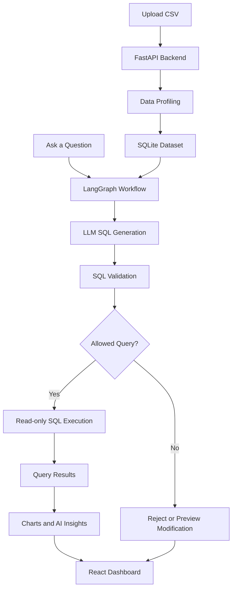

# Ask Your Data — AI-Powered Text-to-SQL Analytics

**Your data. Your questions. Answers in plain English.**

Ask Your Data is an AI-powered analytics application that transforms natural-language questions into SQL queries, query results, interactive visualizations, and AI-generated insights.

Upload a CSV dataset, ask questions about its contents, and explore your data without manually writing SQL. Under the hood, the application combines LLM-powered query generation, LangGraph workflow orchestration, SQL validation, and controlled SQLite execution.

Built with **React, Vite, FastAPI, LangGraph, Google Gemini, SQLite, and SQLGlot**, Ask Your Data explores how AI can make structured-data analytics more accessible while keeping query execution under explicit control.

---

## ✨ Features

- **Natural Language to SQL** — Ask questions about your dataset in plain English and generate SQL queries.
- **CSV Upload and Exploration** — Upload a dataset and inspect its contents through an analytics dashboard.
- **Automatic Data Profiling** — Examine dataset columns, data types, and available profiling statistics.
- **AI Workflow Orchestration** — Coordinate the Text-to-SQL workflow using LangGraph.
- **SQL Validation** — Use SQLGlot to parse and validate generated SQL before execution.
- **Controlled SQL Execution** — Execute permitted read-only `SELECT` queries against SQLite.
- **Modification Query Preview** — Preview supported data-modification statements without executing them.
- **Interactive Visualizations** — Explore query results using charts and tables.
- **AI-Generated Insights** — Turn query results into understandable summaries and data-driven observations.
- **Query Performance Metrics** — Surface execution timing and LLM-call information where supported by the workflow.
- **Modern Analytics Dashboard** — Work with datasets, queries, results, and insights through a dark-themed interface.

## 🖼️ Application Preview

<!-- Add a real screenshot of your dashboard here. -->

<!-- Example:

-->

*Tip: Add a screenshot of your actual application here to help visitors understand the interface immediately.*

## 🧠 How It Works

Ask Your Data connects natural-language input with a controlled data-querying workflow.



### Workflow overview

1. **Upload:** The user uploads a CSV file.
2. **Profile:** The backend processes the dataset and prepares information about its schema and contents.
3. **Ask:** The user submits a natural-language question.
4. **Generate:** The LLM generates a SQL query using the question and available dataset information.
5. **Validate:** The application validates the generated SQL and applies its query-safety rules.
6. **Execute:** Permitted read-only queries run against the SQLite dataset.
7. **Visualize:** The frontend presents the results through tables, charts, and relevant AI-generated insights.

## 🏗️ System Architecture

Ask Your Data uses a frontend–backend architecture with a dedicated AI workflow.

| Component | Technology | Purpose |
|---|---|---|
| Frontend | React, Vite | User interface and analytics dashboard |
| Backend API | FastAPI | HTTP endpoints, file uploads, and request handling |
| AI orchestration | LangGraph | Workflow coordination |
| Language model | Google Gemini | Natural-language understanding and SQL generation |
| SQL validation | SQLGlot | SQL parsing and validation |
| Database | SQLite | Structured dataset storage and query execution |
| Visualization | Recharts | Charts and data visualization |
| Testing | Pytest | Backend testing |

### Engineering principles

**Schema-aware generation**

The query-generation workflow uses information about the uploaded dataset to help generate relevant SQL.

**Validation before execution**

Generated SQL is treated as untrusted input and must pass the application's validation and safety checks.

**Separation of responsibilities**

The frontend handles interaction and presentation, FastAPI handles API requests, and LangGraph coordinates the AI workflow.

**Controlled query execution**

Read-only query execution is separated from modification-query preview handling. This reduces the risk of unintended data changes but does not eliminate every possible security risk.

## 🛠️ Tech Stack

- **Languages:** Python, JavaScript, SQL
- **Frontend:** React, Vite, CSS
- **Backend:** FastAPI
- **AI and orchestration:** Google Gemini, LangGraph
- **SQL and storage:** SQLGlot, SQLite
- **Visualization:** Recharts
- **Testing:** Pytest
- **Version control:** Git and GitHub

## 🚀 Getting Started

Run the frontend and backend locally to explore your own datasets.

### Prerequisites

- Python version compatible with the backend dependencies
- Node.js and npm
- A Google Gemini API key if using the Gemini-backed workflow

### 1. Clone the repository

```bash
git clone https://github.com/YOUR_USERNAME/text-to-SQL.git
cd text-to-SQL
```

Replace `YOUR_USERNAME` with your GitHub username. If you rename the GitHub repository, use its new URL.

### 2. Configure the backend

Create and activate a virtual environment:

**Windows PowerShell**

```powershell
cd backend
python -m venv .venv
.\.venv\Scripts\Activate.ps1
```

Install dependencies using the dependency file included with your backend:

```powershell
pip install -r requirements.txt
```

Configure the required environment variables in a local environment file. For example, if your code expects `GOOGLE_API_KEY`:

```env
GOOGLE_API_KEY=your_gemini_api_key
```

Use the actual variable names expected by your implementation. Never commit real API keys to GitHub.

Start the API using the entry point configured in your project. For example, if the application is exposed as `app.main:app` from the backend directory:

```powershell
uvicorn app.main:app --reload
```

The local API will typically be available at:

`http://127.0.0.1:8000`

If enabled, interactive API documentation is available at:

`http://127.0.0.1:8000/docs`

### 3. Configure the frontend

Open a second terminal:

```powershell
cd frontend
npm install
```

If the frontend supports a configurable API base URL, set it using the environment variable expected by the application. For example:

```env
VITE_API_BASE_URL=http://127.0.0.1:8000
```

Only use this variable name if the frontend code actually reads it. Frontend environment variables prefixed with `VITE_` are exposed to browser code, so never store private credentials in them.

Start the development server:

```powershell
npm run dev
```

Open the local URL printed by Vite.

### 4. Explore your data

1. Upload a CSV dataset.
2. Inspect its structure and profile.
3. Ask a question about its contents.
4. Review the generated SQL and results.
5. Explore the visualizations and AI-generated insights.

## 🧪 Testing

Run the backend test suite from the repository root:

```powershell
python -m pytest backend/tests -v
```

Build the frontend:

```powershell
npm --prefix frontend run build
```

These checks help verify backend behavior and frontend compilation. Passing tests does not, by itself, establish production security or deployment readiness.

## 🔐 Security Considerations

AI-generated SQL must be treated as untrusted input.

Ask Your Data uses SQL validation and controlled execution, but a production deployment requires additional safeguards.

- Keep LLM API keys on the backend.
- Validate uploaded files and enforce upload-size limits.
- Restrict query execution to explicitly permitted operations.
- Use parameterized SQL where applicable.
- Apply appropriate execution timeouts and resource limits.
- Configure CORS for trusted frontend origins.
- Isolate uploaded datasets and session state between users.
- Test against malicious SQL, malformed CSV files, and adversarial inputs.

**Important:** SQL parsing and read-only query restrictions are useful defenses, not a complete security boundary. Verify database isolation, file handling, and concurrency behavior before deploying for multiple users.

## 📂 Project Structure

```text
text-to-SQL/
├── backend/
│   ├── app/
│   │   ├── db.py
│   │   ├── main.py
│   │   ├── profiler.py
│   │   ├── schemas.py
│   │   └── workflow.py
│   └── tests/
│       ├── fixtures/
│       ├── test_api.py
│       ├── test_modifying_sql.py
│       ├── test_profiler.py
│       ├── test_query.py
│       └── test_workflow.py
├── frontend/
│   ├── public/
│   ├── src/
│   │   ├── assets/
│   │   ├── App.jsx
│   │   ├── App.css
│   │   ├── index.css
│   │   └── main.jsx
│   ├── package.json
│   └── vite.config.js
├── .gitignore
└── README.md
```

*This is a simplified overview of the main application files; additional configuration and dependency files may be present.*

## 🗺️ Potential Future Improvements

- Persistent and isolated user workspaces
- Broader SQL-safety and adversarial-input testing
- Evaluation benchmarks for SQL correctness
- Improved handling of ambiguous questions and failed queries
- Support for additional databases
- More detailed observability and performance monitoring
- Rate limiting and production-grade resource controls

These are potential extensions, not claims about currently implemented features.

## 🤝 Contributing

Contributions, suggestions, and bug reports are welcome.

1. Fork the repository.
2. Create a feature branch.
3. Implement your change and add relevant tests.
4. Run the backend tests and frontend build.
5. Submit a pull request describing your changes.

## 📄 License

A license has not been specified here. Add a license file if you intend to grant others explicit permission to reuse, modify, or distribute the project.

---

**Ask Your Data — making data analytics more accessible through natural language and AI.**
